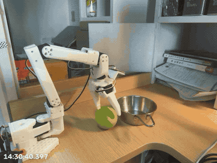
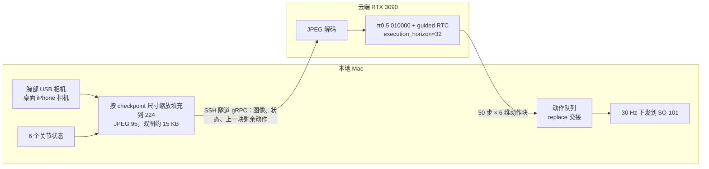
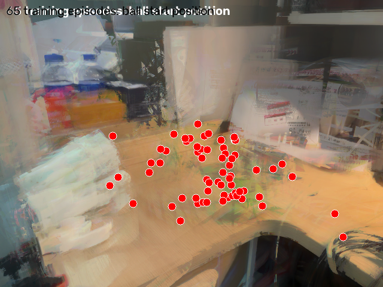

# SO-101 π0.5 真机微调与云端实时部署

在 SO-101 机械臂上完成"抓起绿球放进金属碗"任务：自己遥操作采集示范数据，在开源 SO-101 π0.5 checkpoint 上全量微调，再用云端 GPU 推理加本地 RTC 控制的方式部署到真机。项目包含数据采集、微调、低延迟图像传输、guided RTC 动作块衔接，以及真机评测和失败分析。

**真机连续评测：成功 14/17 次（82%，Wilson 95% 区间 59%–94%）。** 只有一个任务、一个场景、一次训练；样本量小，区间较宽。



[完整评测录像（4 倍速，1 分 48 秒）](media/eval_4x.mp4)：2026-11-07 连续运行约 7 分钟，球放进碗后由人放回桌面，机械臂继续抓取。画面左下角是录制时的墙钟时间。

## 结果

### 任务成功率 · 2026-11-07

| 项目 | 内容 |
| --- | --- |
| 模型 | 自己微调的 010000 checkpoint |
| 方式 | 连续运行（`--duration 0`）；每次放好后由人把球放回桌面不同位置 |
| 逐次结果 | `1 1 1 1 0 1 1 1 1 1 0 1 1 1 1 0 1` |
| 成功率 | **14/17 · 82%**（Wilson 95% 区间 59%–94%） |

成功的标准是球最终留在碗里。成功和失败都是现场人工记录，没有自动判定。

### 实时性与动作衔接（同一次运行，日志统计）

| 指标 | 数值 |
| --- | ---: |
| 运行时长 / 动作块数 | 约 6.9 分钟 / 625 块 |
| 端到端延迟（读相机 → 收到动作块）中位数 / P95 | 0.51 / 0.65 s |
| 云端纯推理（RTX 3090，假数据，无 RTC） | 0.26 s |
| 实际发送动作 | 11,270 步，平均 27.2 Hz（目标 30 Hz） |
| 空队列（无动作可发）次数 | 0 |
| 动作块交接跳变（5 个关节）中位数 / 最大 | 0.51° / 3.69° |
| 交接点超出 RTC 冻结前缀的次数 | 28 / 625 块（超出 1–3 步） |

## 系统结构



推理期间机械臂继续执行上一块的动作。新动作块返回后，从推理期间实际执行到的那一步切换过去（replace）。RTC 用上一块还没执行的动作作为前缀来引导新块的生成，让两块在交接点连续。

## 数据与训练

**数据采集**（[`record/so101_manual_record.py`](record/so101_manual_record.py)，在 LeRobot 录制脚本上改的）
- SO-101 主从臂遥操作，两路相机：`wrist_left`（腕部 USB）和 `desk_view`（iPhone 连续互通相机）。30 FPS，LeRobot 数据格式。
- 任务文本：`Pick up the green ball and place it in the metal bowl.`
- 支持断点续录，可以逐条保存或丢弃。目前共采集 73 条、47,654 帧，**这次训练只用了前 40 条（28,868 帧）**。

**微调**（[`train/`](train/)）
- 起点：Project-IRA 的 [SO-101 π0.5 V7 Full V2](https://huggingface.co/Project-IRA/TPSoSe2026_Pi05_LeRobot_SO101_Finetuning_V7_Full_V2) `008000`。
- 全量微调，视觉编码器不冻结；bf16，开启 gradient checkpointing；batch 16，10,000 步。
- AdamW，峰值学习率 2.5e-5，预热 1,000 步。余弦衰减按 30,000 步设置，但训练在 10,000 步结束，没有走完衰减。
- [`make_ira_train.py`](train/make_ira_train.py) 修改了 LeRobot 训练脚本，让它沿用基座 checkpoint 自带的归一化统计量，而不是用新数据重新计算，这样动作的单位和基座保持一致。完整配置见 [`train_config.json`](train/train_config.json)。

## 部署时解决的问题

1. **传输延迟**：两路原始 640×480 图像打包后约 1.84 MB，在早期的云端实例上，发出观测到收到动作要 1.8 s 左右。改成在本地先按模型的预处理缩放填充到 224×224，再用 JPEG 95 压缩，双图降到约 15 KB。改之前在同一组画面上对比了 gzip（无损）和 JPEG 两种方案。
2. **动作块交接回拉**：最初用 append 方式交接，即在 RTC 引导区的末尾切换到新块，真机上每块都会出现约 7° 的回拉。改成 replace 方式，即在推理期间实际执行到的那一步切换，之后接缝最大约 3–4°。
3. **跨地域推理**：从美国的云 GPU 换到阿里云深圳 RTX 3090。权重放在私有 HF 仓库，通过镜像下载并做 sha256 校验；PaliGemma tokenizer 预先缓存好，服务离线启动。
4. **可追溯**：每次运行都写 JSONL 轨迹，内容包括每个动作块的延迟、交接跳变、下发和读回的关节值；同时录一路带墙钟时间戳的视频，方便事后对齐分析（[`record/record_camera.py`](record/record_camera.py)）。

## 失败分析



- 3 次失败都发生在离机械臂较远的位置，这时手臂要接近完全伸展才能抓到球、再放进碗里。球靠墙角时，模型会犹豫、不去抓。
- 用 HSV 颜色检测统计了 73 条演示首帧中绿球的位置（65 条检测到）。球大多集中在桌面中部，远端和右侧靠墙区域只有零星几个点，和失败位置基本吻合。不过各条演示的桌面相机视角有变化，像素位置只能粗略比较；远端位置是否接近机械臂的可达极限也还没确认。
- 运行中夹爪舵机出现过一次无响应，断电并检查线缆后恢复。

## 局限

- 单任务、单场景、一次训练、17 次试验。没有和未微调的基座 checkpoint 在相同条件下做对比，所以不能说明成功率的提升有多少来自微调。
- 评测是连续运行：每次开始时机械臂停在上一次结束的姿态，而不是数据集里的收起姿态，和训练分布不完全一致。
- 客户端**不限制动作幅度**，退出后扭矩保持开启。不要在无人看管的情况下运行。

## 仓库结构

```
deploy/
  rtc_real_client.py   本地客户端：采图、预处理、JPEG、动作队列、30 Hz 下发、轨迹记录
  append_queue.py      动作块队列（append / replace 两种交接方式）
  joint_trace.py       异步 JSONL 轨迹记录
  rtc_jpeg_server.py   云端 guided RTC 服务（扩展 LeRobot 0.6.1 async gRPC）
  pi05_jpeg_server.py  JPEG 解码；每次推理固定随机种子
  pi05_224_server.py   接收客户端已处理好的 224 图像
  init_policy.py       让服务端加载 checkpoint
  test_append_queue.py 队列逻辑单元测试
record/                遥操作采集、评测录像
train/                 训练脚本补丁、配置、启动脚本
media/                 评测录像
docs/                  分析图
```

## 运行

环境：LeRobot 0.6.1（`lerobot[pi]`）、Python 3.12；服务端需要 CUDA GPU（显存约 10 GB）和已授权的 PaliGemma tokenizer。

```bash
# 云端：启动服务（仅监听 127.0.0.1:8601）
python deploy/rtc_jpeg_server.py --port 8601
# 本地：建立 SSH 隧道 127.0.0.1:8616 -> 云端 127.0.0.1:8601，然后让服务端加载模型
python deploy/init_policy.py --model /path/to/010000/pretrained_model --robot-port /dev/cu.usbmodemXXXX
# 本地：先不带 --execute 空跑核对，再上真机
python deploy/rtc_real_client.py --robot-port /dev/cu.usbmodemXXXX --duration 0 --execute
```

相机序号目前写死在代码里（`0` 是腕部，`2` 是桌面），换设备前需要确认。微调权重和数据集暂未公开。

## 致谢

基于 [LeRobot](https://github.com/huggingface/lerobot)、Physical Intelligence 的 π0.5，以及 [Project-IRA](https://github.com/Project-IRA/interactive-robotic-arm) 开源的 SO-101 checkpoint。`record/so101_manual_record.py` 改自 LeRobot 的录制脚本，保留原 Apache-2.0 版权声明。
